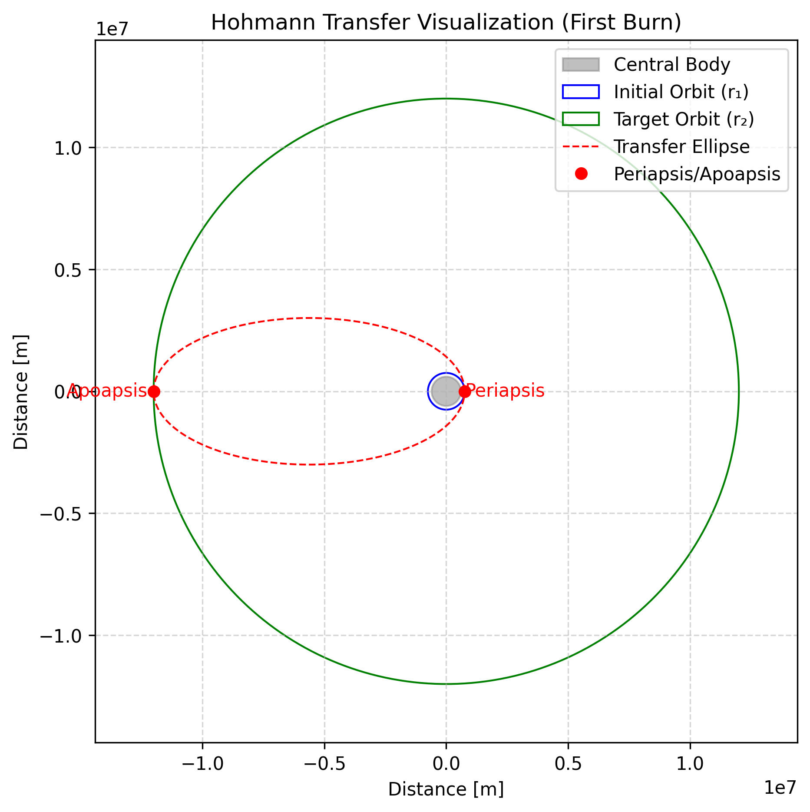
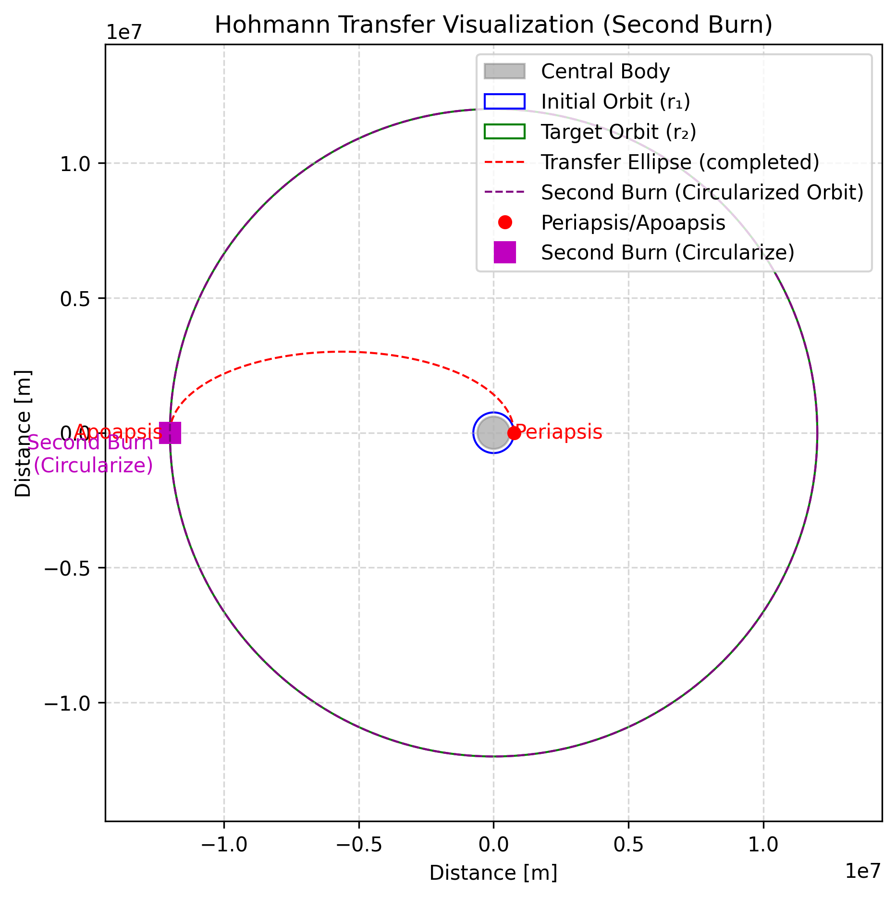

# Hohmann Transfer

## 🚀 Introduction

A **Hohmann transfer** is the classic, most fuel-efficient two-burn maneuver for moving a spacecraft between two **coplanar** circular orbits. The spacecraft first performs a prograde burn to enter an elliptical *transfer* orbit whose periapsis or apoapsis matches the target orbit. After coasting for half an orbital period, a second burn at the opposite side circularizes the orbit at the new radius.

**Why use a Hohmann transfer?**

- Minimizes **∆V** (fuel usage) — ideal when perturbations are negligible.
- Requires only **two short burns** separated by a coast phase; simple to execute.
- Fundamental for interplanetary transfers and rendezvous planning.

---

## Hohmann Transfer: Matching Orbit Radius

### 🔬 Physics Overview

Suppose you want to move from a circular orbit of radius \(r_1\) to another of radius \(r_2\) around the same central body (with gravitational parameter \(\mu\)). The transfer path is an **ellipse** with:

- **Periapsis** at \(r_1\) (your starting orbit)
- **Apoapsis** at \(r_2\) (your target orbit)

**Key parameters:**

- \( r_1 \): Initial orbit radius
- \( r_2 \): Target orbit radius
- \( \mu \): Gravitational parameter of the central body

**Step-by-step:**

1. **Delta-v for the first burn (to enter the transfer ellipse):**

   \[
   \Delta v_1 = \sqrt{\frac{\mu}{r_1}} \left( \sqrt{\frac{2 r_2}{r_1 + r_2}} - 1 \right)
   \]

2. **Delta-v for the second burn (to circularize at \(r_2\)):**

   \[
   \Delta v_2 = \sqrt{\frac{\mu}{r_2}} \left( 1 - \sqrt{\frac{2 r_1}{r_1 + r_2}} \right)
   \]

3. **Semi-major axis of the transfer ellipse:**

   \[
   a = \frac{r_1 + r_2}{2}
   \]

4. **Transfer time (half the period of the ellipse):**

   \[
   t_{\text{tr}} = \pi \sqrt{\frac{a^3}{\mu}}
   \]

> **Tip:** The transfer time formula above is the standard one for half an elliptical orbit. (The previous version had a typo.)

### 📊 Graphs

**Hohmann Transfer First Burn:**

**Hohmann Transfer Second Burn:**

---

## Hohmann Transfer: Intercepting a Target

### 🔬 Physics Overview

The process is the same as above, but now the goal is to intercept a moving target in a different circular orbit. The transfer ellipse still has:

- **Periapsis** at \(r_1\) (your current orbit)
- **Apoapsis** at \(r_2\) (the target's orbit)

**Key parameters:**

- \( r_1 \): Initial orbit radius
- \( r_2 \): Target orbit radius
- \( \mu \): Gravitational parameter

**Step-by-step:**

1. **Delta-v for the first burn:**

   \[
   \Delta v_1 = \sqrt{\frac{\mu}{r_1}} \left( \sqrt{\frac{2 r_2}{r_1 + r_2}} - 1 \right)
   \]

2. **Delta-v for the second burn:**

   \[
   \Delta v_2 = \sqrt{\frac{\mu}{r_2}} \left( 1 - \sqrt{\frac{2 r_1}{r_1 + r_2}} \right)
   \]

3. **Semi-major axis:**

   \[
   a = \frac{r_1 + r_2}{2}
   \]

4. **Transfer time:**

   \[
   t_{\text{tr}} = \pi \sqrt{\frac{a^3}{\mu}}
   \]

5. **Phase angle:**

   \[
   \phi = \pi \left( 1 - \sqrt{\frac{8 r_1^3}{(r_1 + r_2)^3}} \right)
   \]

6. **Current phase angle:**

   \[
   \phi_{\text{current}} = \left( \arctan2(y_{\text{target}}, x_{\text{target}}) - \arctan2(y_{\text{vessel}}, x_{\text{vessel}}) \right) \bmod 2\pi
   \]

7. **Phase difference:**

   \[
   \Delta \phi = \phi_{\text{required}} - \phi_{\text{current}} \bmod 2\pi
   \]

8. **Time until optimal burn:**

   \[
   t_{\text{wait}} = \frac{\Delta \phi}{\omega_{\text{target}}}
   \]
